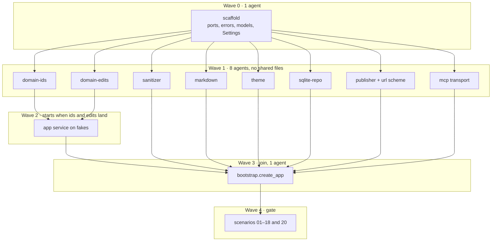

# Implementation plan

MVP: eleven MCP tools, Markdown in, inert HTML out, versions in SQLite, pages on disk. Done when build-kit scenarios 01–18 and 20 pass. Auth (§11.2) and the §12 components (scenario 19) stay out. REST, the CLI, and nginx come after this plan.

Mark a box `[x]` only after that task's exit command passes, and append the commit hash. Mark only the task you own. Leave every `__init__.py` empty until `bootstrap`.

Critical path: `scaffold` → `domain-edits` → `app-service` → `bootstrap` → scenarios. Wave 2 starts as soon as `domain-ids` and `domain-edits` are checked, even if other Wave 1 tasks are still open. `bootstrap` waits for every parent.

## Wave 0

- [x] **scaffold** `9a47362`
  - Owns: `pyproject.toml` dependencies, `pagehost/` package dirs, `pagehost/domain/ports.py`, `pagehost/domain/errors.py`, `pagehost/domain/models.py`, `pagehost/config.py`, `tests/test_architecture.py`, `tests/test_settings.py`, unmodified `pagehost.css` as package data.
  - Exit: `pytest tests/test_architecture.py tests/test_settings.py`
  - Pass means layers import legally (§2.3), and `Settings(data_dir, token, url_template)` exposes `site_root`. Port and service signatures are frozen here. The app accepts a bearer token and does not enforce it.

## Wave 1

Each agent runs `pytest tests/test_architecture.py` plus its own file. After all eight are checked, one run of `pytest tests/test_architecture.py tests/domain tests/adapters tests/transports/test_mcp.py` must pass.

- [x] **domain-ids** `d06626c` — after `scaffold`
  - Owns: `pagehost/domain/ids.py`, `pagehost/domain/normalize.py`, `tests/domain/test_ids.py`
  - Exit: `pytest tests/domain/test_ids.py`
  - Slug, id pattern, five-attempt exhaustion, CRLF to LF, title length, `max_source_bytes`.

- [x] **domain-edits** `f833749` — after `scaffold`
  - Owns: `pagehost/domain/sections.py`, `pagehost/domain/text.py`, `pagehost/domain/edits.py`, `tests/domain/test_appendix_c.py`
  - Exit: `pytest tests/domain/test_appendix_c.py`
  - Appendix C: splice, slugs, ranges, `line_delta`, exact match, near-miss candidates, 4,000 lines in under two seconds.

- [x] **sanitizer** `b84e1ec` — after `scaffold`
  - Owns: `pagehost/adapters/sanitizer.py`, `tests/adapters/test_sanitizer.py`
  - Exit: `pytest tests/adapters/test_sanitizer.py`
  - Appendix D allowlist. Hostile input is inert. Links get `rel="noopener noreferrer"`.

- [x] **markdown** `d5624e1` — after `scaffold`
  - Owns: `pagehost/adapters/markdown.py`, `tests/adapters/test_markdown.py`
  - Exit: `pytest tests/adapters/test_markdown.py`
  - CommonMark, GFM tables, strikethrough, `:::details` and `:::callout`, `headings()`, §4.3 warnings. Calls the sanitizer port. A passthrough double records that `clean()` ran.

- [x] **theme** `f6150f4` — after `scaffold`
  - Owns: `pagehost/adapters/theme.py`, `tests/adapters/test_theme.py`
  - Exit: `pytest tests/adapters/test_theme.py`
  - §8.1 shell, escaped title, no script, class, or inline style. Asset bytes equal the provided `pagehost.css`.

- [x] **sqlite-repo** `57ffd31` — after `scaffold`
  - Owns: `pagehost/adapters/sqlite_repo.py`, `tests/adapters/test_repository.py`
  - Exit: `pytest tests/adapters/test_repository.py`
  - §3.5 on a temp database: WAL, `BEGIN IMMEDIATE`, soft delete, `version_conflict`.

- [x] **publisher** `88630cc` — after `scaffold`
  - Owns: `pagehost/adapters/publisher.py`, `pagehost/adapters/url_scheme.py`, `tests/adapters/test_publisher.py`
  - Exit: `pytest tests/adapters/test_publisher.py`
  - Temp file plus rename, atomic `current` symlink, `unpublish` removes only `current`, `{id}` in the URL template.

- [x] **mcp** `8929031` — after `scaffold`
  - Owns: `pagehost/transports/mcp.py`, `tests/transports/test_mcp.py`
  - Exit: `pytest tests/transports/test_mcp.py`
  - Eleven tools, Appendix A instructions, Appendix B descriptions, §6.3 shapes, §6.5 error JSON. Outline and `since` live here. Tests use a fake service.

## Wave 2

- [ ] **app-service** — after `domain-ids` and `domain-edits`
  - Owns: `pagehost/application/service.py`, in-memory fakes, `tests/application/test_service.py`
  - Exit: `pytest tests/application/test_service.py`
  - §9.1 on fakes: render, then persist, then publish. Identical edits add no version. Id allocation retries. Rollback copies forward. A failed publish is repaired by rerender.

## Wave 3

- [ ] **bootstrap** — after every Wave 1 task and `app-service`
  - Owns: `pagehost/bootstrap.py`, `tests/test_bootstrap.py`
  - Exit: `pytest tests/test_bootstrap.py` and the accumulated unit suite
  - `create_app` mounts `/mcp/`, installs assets, and a publish leaves `<sites>/<id>/current/index.html`. Markdown through the real sanitizer is inert and contains no `<h1>`.

## Wave 4

- [ ] **build-kit scenarios** — after `bootstrap`
  - Owns: `pagehost-build-kit/tests/e2e/conftest.py` only if the entry point must change. It already imports `pagehost.bootstrap.create_app` and `pagehost.config.Settings`.
  - Exit: `pytest pagehost-build-kit/tests/e2e`
  - Scenarios 01–18 and 20 pass. Scenario 19 stays `planned` (`xfail` strict). Then run the mutation check once: one injected fault at a time, and the scenario that pins it fails.

## Already landed

- [x] Acceptance scaffold in `tests/acceptance/`. `e50a263`
- [x] Scenarios 01, 02, 03, 06, 07, 08, 09, 11, 18 in `tests/acceptance/cases.py`. `e50a263`, `1bef74d`, `e827d6c`
- [ ] Wire `tests/acceptance/conftest.py` `driver` to `create_app`. This waits on `bootstrap`. The scenario tests skip until then.

Build-kit scenarios still absent from `tests/acceptance/cases.py`: 04, 05, 10, 12, 13, 14, 15, 16, 17, 19, 20.

## Outside this plan

Auth middleware, §12 components, REST, CLI `rerender`, and nginx. Do not start these from this list.
